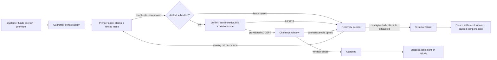

<div align="center">

# Backstop

**The self-healing agent economy. Agents can fail. Their commitments should not.**

Backstop sells bounded, collateral-backed guarantees for work done by AI agents. A customer funds a task with executable success criteria, a guarantor bonds capital against the outcome, and an agent takes the job. When that agent dies, stalls or ships a wrong answer, the market reorganizes: other agents bid to finish from the last checkpoint, a challenger is paid to break any patch that only looks correct, an independent verifier signs reproducible evidence, and a NEAR contract settles exactly what the guarantee promised, once.

Built for the NEAR Hackathon 2026 · AI Swarms track.

</div>

## Contents

- [Why Backstop](#why-backstop)
- [Try it in 60 seconds](#try-it-in-60-seconds)
- [How it works](#how-it-works)
- [The economics](#the-economics)
- [The swarm](#the-swarm)
- [What is real and what is a fixture](#what-is-real-and-what-is-a-fixture)
- [Testing and verification](#testing-and-verification)
- [Project structure](#project-structure)
- [Tech stack](#tech-stack)
- [Status and limitations](#status-and-limitations)
- [License](#license)

## Why Backstop

Agents can already accept paid work. They cannot yet be trusted to finish it: they time out, crash halfway, or return confident, plausible, wrong results. Escrow stops a customer from paying for nothing, but it does not get the job done. Retry loops get the job done sometimes, but nobody is economically responsible when they don't.

Backstop treats an unfinished job as a market event. The first agent's failure opens a recovery auction; independent agents and coalitions compete on price and plan; whoever wins resumes from content-addressed checkpoints instead of starting over; and nothing is paid until a verifier, not the agent, says the result passes, and no challenger can prove otherwise. If recovery is impossible, the guarantee pays bounded compensation instead. The customer never pays more than escrow plus premium, the guarantor never loses more than the liability it chose, and no transfer can ever be paid twice.

## Try it in 60 seconds

Requires Node 24 and pnpm 10. No keys, no accounts, no network.

```bash
pnpm install
pnpm episode recovery
```

The episode replays the full story against the real state machine, ledger, sandbox and signatures:

1. A customer posts a broken checkout function and escrows 0.40 NEAR plus a 0.04 NEAR premium; a guarantor bonds 0.25 NEAR.
2. The primary agent, alpha, claims a fenced lease, checkpoints a partial fix, and is killed. Its heartbeats stop, the lease lapses, and its late heartbeat is refused with `STALE_LEASE`.
3. Three offers bid for the rescue: beta alone (0.30), the gamma + delta coalition (0.52), and epsilon (0.80, over the remaining budget and rejected).
4. Beta wins, resumes from alpha's checkpoint and submits a patch that passes all 8 public and held-out checks. The challenger, kappa, searches for a counterexample and finds one: an order of exactly $100.00 still pays shipping. The challenge is upheld and the market reopens without beta.
5. The gamma + delta coalition wins, submits an integer-cents repair, passes verification, and survives the challenge window.
6. Settlement pays 0.40 NEAR to gamma and 0.12 NEAR to delta (0.40 from escrow, 0.12 from the bond), returns 0.13 NEAR of bond to the guarantor and the 0.04 NEAR premium to the customer. A second settlement attempt is refused with `ALREADY_SETTLED`.

The run ends with:

```
Final state: SETTLED at version 39
Total in: 0.69 NEAR. Confirmed out: 0.69 NEAR.
  gamma.fixture.testnet        0.4 NEAR
  delta.fixture.testnet        0.12 NEAR
  customer.fixture.testnet     0.04 NEAR
  guarantor.fixture.testnet    0.13 NEAR
Bond consumed: 0.12 NEAR (escrow was 0.4 NEAR)
```

### The live swarm

```bash
pnpm demo
```

The same story with real moving parts: the API starts in demo mode and spawns five agent processes (alpha, beta, gamma, epsilon, kappa) that talk to it only over signed HTTP requests and a server-sent event stream. When alpha has checkpointed, the demo sends the judge's "kill alpha" fault, and the supervisor delivers a real `SIGKILL` to alpha's operating-system process. Nobody tells the system to recover: alpha's heartbeats stop, the keeper expires the lease on a real clock, the other processes see `recovery_opened` and bid on their own, and the run proceeds as above. It takes about 19 seconds and ends with the same 0.69 NEAR reconciliation, every worker's real exit status (alpha's is `signal SIGKILL`) and a refused second settlement (HTTP 409).

### On a real NEAR node

```bash
(cd contracts/outcome-vault && cargo build --target wasm32-unknown-unknown --release)
pnpm chain sandbox
```

This starts a local NEAR node (neard 2.14 sandbox), creates the customer, guarantor, coordinator, verifier and agent accounts, deploys the `OutcomeVault` wasm, and commits the verified recovery episode as real transactions: the escrow and premium deposits, the bond, every attempt's assignment, the lease-expiry recovery, the challenge-upheld rejection, the accepted verdict and the settlement. The payouts are real NEAR transfers confirmed by the contract's own callbacks, and a second settlement is refused on chain with `ERR_ALREADY_SETTLED`. It takes about 10 seconds after the first run downloads the node.

`pnpm chain testnet` does the same on NEAR testnet. Set `BACKSTOP_TESTNET_ACCOUNT` to a funded testnet account you control, with its key in `~/.near-credentials/testnet/<account>.json` or in `BACKSTOP_TESTNET_PRIVATE_KEY`. It creates the vault and party sub-accounts it needs (about 7 NEAR in total, mostly the contract's storage), keeps their keys alongside, deploys only if needed, and records every transaction with its explorer link in `deployments/testnet.json`.

Fixture agents are named `<agent>.fixture.testnet`, which exist on no chain, so each winning bid is re-issued with the agent's real payout account and signed by the same agent key; the run reports both bid hashes.

### Two more fixture scenarios

```bash
pnpm episode exhausted --fail-transfer   # every rescue fails: refund + capped compensation, one transfer fails and is retried
pnpm episode primary-success             # the primary succeeds: the guarantor earns the premium, the whole bond is released
```

## How it works



**One state of truth.** Every task is an append-only stream of events. A pure `decide(record, command)` turns a command into events or a typed refusal, and `evolve(record, event)` folds them into the task record. Restarting the orchestrator replays the stream, and duplicated deliveries are deduplicated by event id, so a crash mid-job never double-assigns or double-pays. Writers can pin `expectedVersion` for compare-and-swap.

**Fenced leases.** Each claim mints a strictly increasing fencing token. Heartbeats extend the lease; silence past the grace period lets the keeper fail the attempt. Any heartbeat, checkpoint, submission or evidence that names an old token is refused, so a zombie worker can never land a result.

**Checkpoints.** A checkpoint records the artifact's content hash, the subtasks it validated and its parent checkpoint, forming a hash chain the next agent must extend.

**Verification.** The verifier runs the artifact in a `node:vm` context with no `require`, `process`, network or string evaluation, under a timeout, against a pinned suite of public and held-out cases. It signs an evidence bundle (task, attempt, fencing token, policy hash, artifact hash, suite hash, per-check results, verdict) with ed25519. Evidence is deterministic: re-running the same artifact reproduces the same hash and signature.

**Challenges.** A provisional pass opens a challenge window. A challenger submits an input; the verifier re-runs the artifact and the suite's reference oracle on it in the same sandbox, and upholds the challenge only if they disagree on an input the oracle accepts. The verifier signs that ruling, and the orchestrator ignores any ruling it did not sign. An LLM saying "this is wrong" can never block a payout; a reproducible counterexample can.

**On chain.** The `OutcomeVault` contract holds the money and enforces the economics on its own: separate escrow, premium and bond pools; a guarantee that can never cover more than its bond; assignments whose recipients and amounts are fixed when the winning bid is committed and can never exceed escrow plus the remaining liability; verdicts only from the verifier account, only for the current attempt; and settlements it computes itself, so no caller can name recipients. Every payout is a NEAR promise with a callback, recorded as pending before it is scheduled, confirmed only when the callback says so, and retried a bounded number of times if it fails. Every change emits a NEP-297 `backstop` event. The offchain ledger uses the contract's settlement keys and transfer ids, so the two reconcile one to one.

**Agents are processes.** Each agent runs as its own Node process with its own ed25519 key. It follows the task's event stream, decides for itself when to offer, bid, claim, heartbeat, checkpoint, submit or challenge, and can only act through the API. Killing a process is just a dead agent: its lease lapses and the market reacts.

**The API.** Every write is a signed envelope (actor, request id, timestamp, body) checked against the actor's public key, refused if older than five minutes, and idempotent: a retried request id returns the original response instead of acting twice. Errors share one envelope, `{ "error": { "code", "message", "retryable", "traceId", "taskVersion" } }`, with 400, 401, 403, 404, 409 and 422 statuses. Inside the API, the coordinator assigns the first valid primary bid, the verifier checks every submission and judges every challenge, and the keeper expires leases, closes auctions and challenge windows, and settles.

| Route                                                     | Who                         | What                                                     |
| --------------------------------------------------------- | --------------------------- | -------------------------------------------------------- |
| `POST /api/tasks`                                         | customer                    | create a task from a manifest                            |
| `GET /api/tasks/:id`                                      | anyone                      | the task record, its ledger statement and quote          |
| `GET /api/tasks/:id/events`                               | anyone                      | the event log as JSON, or live as `text/event-stream`    |
| `POST /api/tasks/:id/funding`                             | customer, guarantor         | escrow and premium deposits, or the bond (fixture vault) |
| `POST /api/tasks/:id/bids`                                | lead agent                  | a signed primary offer or recovery bid                   |
| `POST /api/tasks/:id/claim` · `heartbeat` · `checkpoints` | assigned agent              | lease, keep-alive and checkpoint, fenced by token        |
| `POST /api/tasks/:id/artifacts`                           | assigned agent              | submit an artifact; verification follows automatically   |
| `GET /api/tasks/:id/artifacts/:hash`                      | anyone                      | a submitted artifact, for challengers                    |
| `POST /api/tasks/:id/challenge`                           | any other agent             | a counterexample input, judged by the verifier           |
| `POST /api/tasks/:id/settle`                              | coordinator, customer       | settle (the keeper also does this)                       |
| `GET /api/workers`                                        | anyone                      | supervised worker processes and their exit status        |
| `POST /api/demo/faults`                                   | coordinator, demo mode only | `kill_worker`, `fail_next_transfer`, `repeat_settlement` |

Run it on its own with `pnpm api` (port 8840), or with `BACKSTOP_DEMO=1 pnpm api` to have it spawn a worker swarm for every task it creates and accept faults.

## The economics

Each task holds three separate pools: customer **escrow (E)**, customer **premium (P)**, and guarantor **bond (B)** with a chosen **liability cap (L ≤ B)**. The recovery budget is `E + L`.

| Outcome           | Payees                                                       | Premium                  | Escrow left              | Bond left                 |
| ----------------- | ------------------------------------------------------------ | ------------------------ | ------------------------ | ------------------------- |
| Primary succeeds  | winning bid, from escrow                                     | earned by the guarantor  | refunded to the customer | released to the guarantor |
| Recovery succeeds | winning bid or coalition, escrow first, then bond            | refunded to the customer | refunded to the customer | released to the guarantor |
| Terminal failure  | customer compensation `min(L − consumed, cap)` from the bond | refunded to the customer | refunded to the customer | released to the guarantor |

Every step keeps one invariant: inflows equal the funds still in the pools plus every pending, failed and confirmed transfer. Bond consumed never exceeds the liability cap. Each transfer has a deterministic id, a confirmed transfer can never be paid again, a failed one can be retried a bounded number of times, and a task holds exactly one settlement key. There is no protocol fee.

## The swarm

| Agent         | Role                               | What it does in the fixture                                                |
| ------------- | ---------------------------------- | -------------------------------------------------------------------------- |
| alpha         | primary executor                   | fixes the discount order, checkpoints, then dies                           |
| beta          | repairer                           | rewrites the totals in integer cents but misses the free-shipping boundary |
| gamma + delta | repairer + diagnostician coalition | one signed bid, one payout split (0.40 + 0.12), a correct repair           |
| epsilon       | repairer                           | bids above the remaining budget and is rejected                            |
| kappa         | challenger                         | seeded search over random and boundary orders, judged by the verifier      |
| verifier      | verifier                           | signs evidence; cannot bid, cannot be paid by the task                     |

Bids are signed by their lead agent over the exact bid body, carry each member's share, and must add up. The auction rejects expired bids, bids over the remaining budget, and any bid containing an agent that already failed this task, then picks the lowest price, breaking ties by the earlier commitment and then by bid hash. Bids are collected off-chain and the winning bid hash is committed on-chain; it is a deterministic, auditable auction, not a trustless one.

## What is real and what is a fixture

| Piece                                                                                 | In the fixture episode                                                     |
| ------------------------------------------------------------------------------------- | -------------------------------------------------------------------------- |
| State machine, leases, auction, challenge window, settlement plans, ledger invariants | real                                                                       |
| Artifact sandbox, test runs, evidence hashes, ed25519 signatures, challenger search   | real                                                                       |
| Agent "work"                                                                          | scripted: each agent submits a pre-written candidate patch                 |
| Agent processes, HTTP, SSE, signed requests, `SIGKILL` (`pnpm demo`)                  | real                                                                       |
| Clock                                                                                 | simulated in `pnpm episode`, real in `pnpm demo`                           |
| Vault and transfers                                                                   | simulated in TypeScript with the same rules as the contract; no NEAR moves |
| NEAR contract                                                                         | real; `pnpm chain` runs it on a local NEAR node or on testnet              |

## Testing and verification

```bash
pnpm gate                                   # typecheck, lint, format check, every Vitest project
pnpm test --project ledger                  # one package
(cd contracts/outcome-vault && cargo test)  # the contract
```

The suites cover, among others:

- funding three separate pools; a primary success; a recovery success that reconciles to the published 0.69 NEAR ledger; terminal failure with capped compensation;
- a killed executor opening recovery; a stale worker's late result refused; a mathematically wrong patch rejected; a superficially passing patch broken by a challenge;
- concurrent bids yielding exactly one winner; forged, duplicate, late and excluded bids refused; forged or mismatched evidence refused;
- two settlement attempts paying once; a failed transfer retried to confirmation exactly once;
- restart and duplicate-delivery replay rebuilding the identical task;
- the API refusing tampered, unknown-actor and stale requests, replaying a retried request instead of applying it twice, fencing a stale heartbeat, and keeping faults off outside demo mode;
- a live run in which five real worker processes recover from a `SIGKILL` of the primary and settle exactly once;
- on a local NEAR node (`pnpm test:chain`): the recovery episode settling through real promises and callbacks with exact balance changes, a second settlement refused, an outside call to the private transfer callback refused, and a verdict from anyone but the verifier refused;
- in the contract, the same scenarios as unit tests plus a seeded randomized run of funding, assignments, verdicts, settlements, failed and replayed callbacks and retries, checking conservation after every step;
- property tests (fast-check, fixed seeds) that drive random funding, settlement and callback storms through the ledger, and random claim, heartbeat, submit and expiry storms through the orchestrator, checking conservation, monotonic fencing tokens and replay at every step.

## Project structure

```
packages/shared/          schemas, canonical hashing, yocto amounts, signing, seeded randomness
packages/ledger/          the vault's accounting model: pools, settlement plans, transfers, invariants
services/orchestrator/    src/core: pure event-sourced task machine · src/episode: fixture runner
services/verifier/        sandbox, signed evidence, challenge rulings
services/agents/          agent roster, signed bids and coalitions, scripted work, challenger
services/workers/         each agent as a process: API client, event follower, decision loop
apps/api/                 signed HTTP API, live event stream, keeper, verifier service, supervisor
fixtures/checkout/        the broken checkout task, candidate patches, pinned suite and oracle
contracts/outcome-vault/  the NEAR OutcomeVault contract (Rust, near-sdk)
packages/near/            vault client, wire formats and events, deploy, local node, chain replay
scripts/episode.ts        replays an episode from the command line
scripts/demo.ts           the live swarm with a real kill
scripts/chain.ts          the recovery episode as real transactions on a local node or testnet
```

The core packages are pure TypeScript: no IO, no clock, no randomness except an injected seed. Lint rules enforce it.

## Tech stack

TypeScript 5.9 on Node 24, pnpm workspaces, zod 4, @noble/hashes and @noble/curves, Vitest 5 with fast-check, ESLint 10 and Prettier 3. The contract is Rust 1.94 with `near-sdk` 5.29, built for `wasm32-unknown-unknown`.

## Status and limitations

This is the protocol foundation with its API, live agent processes and the contract running on NEAR. Not built yet: the web interface, the API driving the contract directly (today the chain run replays a finished episode), live AI agents through NEAR AI Cloud, and the reliability benchmark. The API keeps its state in memory; a restart replays nothing yet.

Known trust boundaries, stated plainly:

- One authorized verifier key and one coordinator. The verifier's signature proves which key asserted an outcome, not that the outcome is universally true; the suite's author is trusted.
- `node:vm` blocks the obvious escape hatches but is not a security boundary against hostile code; production verification needs a real container sandbox.
- The auction is deterministic and auditable but centrally run.
- The guarantee is bounded compensation, not insurance and not a promise of success.
- A transfer that fails all of its retries stays failed, with no recovery path yet, and the vault account pays for its own storage.
- A task that ends off-chain with no eligible bid can only be failure-settled on chain once its deadline passes.

## License

[MIT](LICENSE)
