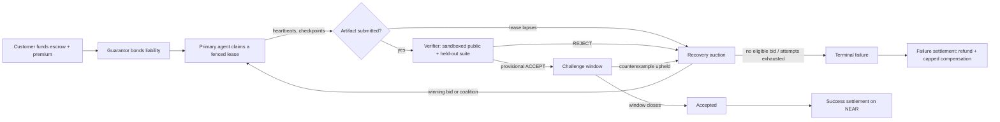

<div align="center">

# Backstop

**The self-healing agent economy. Agents can fail. Their commitments should not.**

Backstop sells bounded, collateral-backed guarantees for work done by AI agents. A customer funds a task with executable success criteria, a guarantor bonds capital against the outcome, and an agent takes the job. When that agent dies, stalls or ships a wrong answer, the market reorganizes: other agents bid to finish from the last checkpoint, a challenger is paid to break any patch that only looks correct, an independent verifier signs reproducible evidence, and a NEAR contract settles exactly what the guarantee promised, once.

Built for the NEAR Hackathon 2026 · AI Swarms track · every line written during the hackathon (first commit 13 Nov 2026).

</div>

## Judge path: do this, see that

Requires Node 24 and pnpm 10. No keys, accounts or network are needed for the first three rows.

| Do                                                                      | See                                                                                                                                                                                    | What it proves                                                                                                                                                                                                         |
| ----------------------------------------------------------------------- | -------------------------------------------------------------------------------------------------------------------------------------------------------------------------------------- | ---------------------------------------------------------------------------------------------------------------------------------------------------------------------------------------------------------------------- |
| `pnpm install && pnpm episode recovery`                                 | `Final state: SETTLED`, `Total in: 0.69 NEAR. Confirmed out: 0.69 NEAR.`, two `REFUSED STALE_LEASE` and one `REFUSED ALREADY_SETTLED`                                                  | The whole mechanism: a killed primary, a recovery auction, a coalition that forms by consent, a passing patch broken by a challenger, a verified repair, and a settlement that conserves every yoctoNEAR and pays once |
| `pnpm demo`                                                             | six agent processes, `judge: kill alpha`, `worker alpha ... signal SIGKILL`, `Final state: SETTLED (success)`, `settle again -> HTTP 409`                                              | The same recovery with real processes, a real `SIGKILL`, signed HTTP and a real clock; nobody tells the swarm to recover                                                                                               |
| `pnpm demo --intents`                                                   | after settlement, `[intents] delta's 0.12 NEAR payout -> … USDC on Base … (dry quote, signed …)`                                                                                       | Intent-based settlement: a payee's NEAR payout quoted by NEAR Intents into the asset and chain it asked for (needs network; nothing is swapped)                                                                        |
| `pnpm vault:build && pnpm demo --chain sandbox`                         | the live run with `[near] …: ok` lines for every deposit, commitment and verdict, `task_settled` recorded by `near-indexer`, and `settle again on NEAR -> refused ERR_ALREADY_SETTLED` | The live swarm settling on a real NEAR node as it happens: money moves only when the contract says so                                                                                                                  |
| `pnpm test`                                                             | `117 passed`                                                                                                                                                                           | Ledger conservation and idempotency (property-tested), fencing, the auction, coalition consent, verifier and challenge signatures, the API, and a live `SIGKILL` run                                                   |
| `pnpm vault:build && pnpm chain sandbox`                                | eleven transactions ending `On-chain ledger: SETTLED, in 0.69 NEAR, confirmed out 0.69 NEAR`, the repeat settlement `refused ERR_ALREADY_SETTLED`                                      | The NEAR contract enforcing the same economics with real promise transfers and callbacks on a local NEAR node (Rust toolchain needed)                                                                                  |
| `pnpm tee attest`                                                       | five `ok` lines per enclave instance (nonce, key, Intel `tdx` `UpToDate`, `binding`, NVIDIA `gpu`), then `Attested signing key(s) for deepseek-ai/DeepSeek-V4.1-Flash-1017: 0xfe00…`   | NEAR AI Cloud's enclave key verified from scratch with a fresh nonce: no API key, and no trust in NEAR AI's word (needs network)                                                                                       |
| `pnpm verify:testnet`                                                   | `52 of 52 checks passed`                                                                                                                                                               | Every testnet claim in this README re-checked against the chain, including that the deployed code is the published reproducible build (needs network; CI reruns it daily)                                              |
| Open the testnet links in [Live on NEAR testnet](#live-on-near-testnet) | eleven transactions on `vault.backstop-6501bb.testnet`; the settlement shows four transfer receipts and `task_settled`; the repeat shows `ERR_ALREADY_SETTLED`                         | The same economics enforced by the deployed contract on NEAR testnet, with real NEAR moving between sub-accounts                                                                                                       |
| `pnpm arena`                                                            | a Backstop-versus-single-agent table over 32 seeded fault cases, `violations 0 0`                                                                                                      | The mechanism holds across combinations of faults, not just one path; raw rows land in `benchmarks/`                                                                                                                   |
| `pnpm market`, then connect an agent to `pnpm mcp`                      | a task whose patch passed all 8 checks, held open for challenges; your agent's counterexample comes back `attempt_rejected`                                                            | The challenger market is open: any outside agent (Claude Code, Cursor) can join over MCP with its own key, and the verifier re-runs its challenge before anything changes                                              |
| `(cd contracts/outcome-vault && cargo test)`                            | `45 passed`                                                                                                                                                                            | The contract's own unit tests, including a seeded randomized run that replays stale callbacks and checks conservation after every step                                                                                 |

## Live on NEAR testnet

The `OutcomeVault` contract is deployed at [`vault.backstop-6501bb.testnet`](https://testnet.nearblocks.io/address/vault.backstop-6501bb.testnet). Every party is its own NEAR sub-account of the operator account `backstop-6501bb.testnet`: the vault, the customer, the guarantor, the coordinator, the verifier and each agent (`gamma.backstop-6501bb.testnet`, `delta.backstop-6501bb.testnet`, …). Task `checkout-mwgbt9k9` replays a verified recovery episode as real transactions (recorded 2026-11-14, also in [`deployments/testnet.json`](deployments/testnet.json)):

| Step                                                       | Result                      | Transaction                                                                                    |
| ---------------------------------------------------------- | --------------------------- | ---------------------------------------------------------------------------------------------- |
| Deploy the `OutcomeVault` wasm                             | ok                          | [3xyHBrhZNR…](https://testnet.nearblocks.io/txns/3xyHBrhZNRfKafZRNw4LbMYUREY5DiAUHFKYxqqxqewW) |
| Customer creates the task and escrows                      | success                     | [bkdgUQPc2C…](https://testnet.nearblocks.io/txns/bkdgUQPc2CNFmS6Z1NJKSBFK1DCQgLfW7gFJReZDSHP)  |
| Customer pays the premium                                  | success                     | [44jfHka6TZ…](https://testnet.nearblocks.io/txns/44jfHka6TZASf7i4N9KKDG86dYrAnfPH9Z39wyhZCEiX) |
| Guarantor bonds the outcome                                | success                     | [DWuECbyiQP…](https://testnet.nearblocks.io/txns/DWuECbyiQP5rR9XjvAnPsWrmErUAJTs3vktPtgVwZtbg) |
| Coordinator commits attempt 1 to alpha                     | success                     | [2pAWDiZubo…](https://testnet.nearblocks.io/txns/2pAWDiZuboT5wMTWSMvCk6qxbfmRy9Q9C8qmiMAeAtwW) |
| Coordinator opens recovery after attempt 1 (LEASE_EXPIRED) | success                     | [7dyU8dC4Bq…](https://testnet.nearblocks.io/txns/7dyU8dC4Bqzrn5fX8QsQiSDqDDxcnVTpYt7CN7uFKdxk) |
| Coordinator commits attempt 2 to beta                      | success                     | [85AttME1Ai…](https://testnet.nearblocks.io/txns/85AttME1AiDKBwPvMYh9rt2B8KfTMkTgfK7evSm7btvU) |
| Verifier records REJECT for attempt 2                      | success                     | [8L6QQPLSjy…](https://testnet.nearblocks.io/txns/8L6QQPLSjyF5t3hcKaLXwMdNTqVvP1EkRmBejvf5yY6F) |
| Coordinator commits attempt 3 to gamma                     | success                     | [2KquPafVSG…](https://testnet.nearblocks.io/txns/2KquPafVSGvR8UQZg1uWzoTHTLjqFYLoWbwW9WT7Faz2) |
| Verifier records ACCEPT for attempt 3                      | success                     | [2wDd6bCRsV…](https://testnet.nearblocks.io/txns/2wDd6bCRsVromTGLDYUryQPVU6TPmd1cBeGy6sphgQyV) |
| Coordinator finalizes the success settlement               | success                     | [SnGxGJrzuM…](https://testnet.nearblocks.io/txns/SnGxGJrzuM9KEya69gXdzxH6NA16tQ9yji5P6Cya3dk)  |
| A repeated settlement is refused                           | refused ERR_ALREADY_SETTLED | [HAL7MY7Aqk…](https://testnet.nearblocks.io/txns/HAL7MY7Aqk1QuVEDmvawpDkZjLFy1fZ7JtENQV1s3dvj) |

The settlement transaction's receipts land at gamma (0.40 NEAR), delta (0.12), the customer (0.04 premium refund) and the guarantor (0.13 bond release), each confirmed by the vault's own callback, and the task's on-chain ledger reads 0.69 NEAR in, 0.69 NEAR confirmed out, nothing pending. The repeated settlement fails on chain with `ERR_ALREADY_SETTLED`. To reproduce on your own account: `pnpm chain:account`, then `BACKSTOP_TESTNET_ACCOUNT=<that account> pnpm chain testnet`.

### The live swarm, settling on testnet

`BACKSTOP_TESTNET_ACCOUNT=<your account> pnpm demo --chain testnet --intents` runs the live swarm against the deployed vault: six agent processes over signed HTTP, a real `SIGKILL` of alpha, and every deposit, commitment, verdict and payout as a NEAR transaction while it happens. Deposits reach the contract before the task records them; the task settles only when the contract's own transfer callbacks are indexed back. Task `checkout-live-69690` (recorded 2026-11-14; alpha's process exited with `signal SIGKILL`):

| Step                                                       | Result                      | Transaction                                                                                    |
| ---------------------------------------------------------- | --------------------------- | ---------------------------------------------------------------------------------------------- |
| Customer creates the task and escrows                      | success                     | [5xx7TEeKk2…](https://testnet.nearblocks.io/txns/5xx7TEeKk2ry9bqicHyFVCfudzVShwBgToZq6bKpyYBv) |
| Customer pays the premium                                  | success                     | [A1c7VE8XvM…](https://testnet.nearblocks.io/txns/A1c7VE8XvMrzdotQrY6yQ2xQoRgMGewrWwdb75EroSVD) |
| Guarantor bonds the outcome                                | success                     | [3m6A5ioztL…](https://testnet.nearblocks.io/txns/3m6A5ioztLyVH5e4nhvURoP6E6CZfMKeyVrsVE5Zg6wx) |
| Coordinator commits attempt 1 to alpha                     | success                     | [6eK322mv62…](https://testnet.nearblocks.io/txns/6eK322mv62mZhuQ8ZhBfxtboVqX73hVp9ZGu8c9Le4Xf) |
| Coordinator opens recovery after attempt 1 (LEASE_EXPIRED) | success                     | [71XNVeXp4A…](https://testnet.nearblocks.io/txns/71XNVeXp4AU9BtrPj7jbLsAjJt7xT4FMiT5ZXdGfySj8) |
| Coordinator commits attempt 2 to beta                      | success                     | [6MDd873Lis…](https://testnet.nearblocks.io/txns/6MDd873LishTfJBkwz1ygrLgmSYTymrUSGxRGyLoqEWW) |
| Verifier records REJECT for attempt 2                      | success                     | [BSNEcuHfxr…](https://testnet.nearblocks.io/txns/BSNEcuHfxrjYuN1L8LBrE4VPjSYg5PboaEm1Mzq9Pypp) |
| Coordinator commits attempt 3 to gamma                     | success                     | [H8UWWgyBAb…](https://testnet.nearblocks.io/txns/H8UWWgyBAb53BhPQmTmCD38BiyiuQBLUtinufhNU7143) |
| Verifier records ACCEPT for attempt 3                      | success                     | [FrNCGTCyCD…](https://testnet.nearblocks.io/txns/FrNCGTCyCDnZLuegKE8Uv8yt2cm3T8TfxD8PgtGyk8iZ) |
| Coordinator finalizes the success settlement               | success                     | [2vDxabn6Fi…](https://testnet.nearblocks.io/txns/2vDxabn6Fiqn2VhCpcB7jQvBCo1tG5wBCF6S8bkYbjG1) |
| A repeated settlement is refused                           | refused ERR_ALREADY_SETTLED | [HUqsGDeWMV…](https://testnet.nearblocks.io/txns/HUqsGDeWMVGwmtKNzBeaQYRHv8tCoHuqXwxow9WoRECm) |

After settlement, delta's 0.12 NEAR payout was quoted by NEAR Intents as 0.396993 USDC on Base in about 14 seconds (a dry-run quote signed by 1Click, recorded with the run in `deployments/testnet.json`).

## Contents

- [Live on NEAR testnet](#live-on-near-testnet)
- [TEE-verified AI](#tee-verified-ai)
- [Verify every claim](#verify-every-claim)
- [Why Backstop](#why-backstop)
- [Try it in 60 seconds](#try-it-in-60-seconds)
- [How it works](#how-it-works)
- [Intent-based payouts](#intent-based-payouts)
- [Attacks Backstop refuses](#attacks-backstop-refuses)
- [Reliability arena](#reliability-arena)
- [The economics](#the-economics)
- [The swarm](#the-swarm)
- [What is real and what is a fixture](#what-is-real-and-what-is-a-fixture)
- [Testing and verification](#testing-and-verification)
- [Project structure](#project-structure)
- [Tech stack](#tech-stack)
- [Status and limitations](#status-and-limitations)
- [License](#license)

## TEE-verified AI

A live agent's patch is worth paying for only if the model really wrote it and nobody edited it on the way. Live AI mode runs a model that NEAR AI Cloud serves inside a trusted execution environment (Intel TDX with NVIDIA confidential-computing GPUs), and Backstop refuses to count an AI patch whose provenance it cannot check, in the API and again in the vault contract.

1. **Attest the enclave independently.** `pnpm tee attest` asks NEAR AI Cloud for the model's attestation with a fresh random nonce and checks it without an API key and without taking NEAR AI's word for anything. Intel DCAP verifies the TDX quote against Intel's collateral (TCB `UpToDate`). The quote's report data must commit to the signing address and our nonce, and the published public key must hash to that address. NVIDIA's attestation service must pass the GPUs, with its ES384 token verified against NVIDIA's published keys and carrying our nonce. A key that fails any check is not trusted.
2. **Register the key on the vault.** The vault owner registers an attested key for exactly one model, with the attestation's digest. On testnet, `0xfe0071895500a9755c18044948ab4f4e1a7f337e` is registered for `deepseek-ai/DeepSeek-V4.1-Flash-1017` in [2ydXyZh4Tv…](https://testnet.nearblocks.io/txns/2ydXyZh4TvNUogitknatatAyqtiYGiyALKgESQCkAdS4) (14 Nov 2026, both enclave instances attested).
3. **Carry the receipt with the patch.** The worker keeps the exact request and reply bytes and fetches NEAR AI's signature over `model:sha256(request):sha256(reply)`. The API accepts the patch only if that signature recovers to an attested key, both hashes match, and the signed reply contains exactly the submitted code; anything else is HTTP 422.
4. **Check it again on chain.** The verifier signs the receipt into its evidence, and the ACCEPT reaches the vault as `record_attested_verdict`. The contract recovers the signer with `ecrecover` from the EIP-191 digest, refuses any key it has not registered for that model (`ERR_UNKNOWN_TEE_SIGNER`, `ERR_INFERENCE_MODEL`), and stores the request and reply hashes beside the verdict.

What is live and what is not: the attestation and the on-chain key registration above are real and repeatable. A live-model run needs a NEAR AI Cloud API key, which this repository does not hold, so the receipt path is exercised with a simulated enclave key: against the real contract on a local NEAR node (`pnpm test:chain`), in the contract's unit tests (the TypeScript signer and the contract's `ecrecover` agree on one vector), and through the API's refusals. The attestation code is also tested offline against a recorded real report, quote, Intel collateral and NVIDIA token. NEAR AI's Anthropic models run outside its TEE (its attestation endpoint says so), which is why live mode defaults to DeepSeek V4.1 Flash. The attestation proves that a genuine, current Intel TDX machine with attested NVIDIA GPUs holds the key for that model name; it does not compare the enclave's image measurement against a reproducible build of NEAR AI's serving stack.

## Verify every claim

```bash
pnpm verify:testnet
```

This re-reads every transaction in `deployments/testnet.json` from NEAR testnet and checks its recorded outcome and signer. It checks that each task's on-chain ledger is settled, with inflow equal to confirmed outflow and nothing pending or failed; that the registered enclave key carries the recorded attestation digest; and that the code on the vault is the published build. It passes 52 of 52 checks (14 Nov 2026), and a scheduled workflow reruns it daily and whenever the record changes.

The contract builds reproducibly. `pnpm vault:build` remaps every machine-specific path, and on Linux x86-64 with Rust 1.94.1 the wasm's SHA-256 is the one in `contracts/outcome-vault/outcome_vault.wasm.sha256` (`47fb3f27…`). CI fails if its build drifts from that hash and publishes the wasm it built, and a clean container produces the same digest:

```bash
docker run --rm --platform linux/amd64 -v "$PWD":/work -w /work rust:1.94.1 \
  sh -c "rustup target add wasm32-unknown-unknown && sh scripts/build-vault.sh"
```

NEAR reports a contract's code hash as the base58 form of the same digest: `5qz9ivSg64LkdkoHoLRNZhMPPpcHHYNvvGNF9MgXvZAa` on `vault.backstop-6501bb.testnet`. That build went live as an in-place upgrade, deploy and state migration in one transaction ([Esf2QSVUeq…](https://testnet.nearblocks.io/txns/Esf2QSVUeqvW8dBJtWR9dZ1j5d3LDkjZdNWjrFLVjMbp)), and every task recorded before it still reads back settled.

## Why Backstop

Agents can already accept paid work. They cannot yet be trusted to finish it: they time out, crash halfway, or return confident, plausible, wrong results. Escrow stops a customer from paying for nothing, but it does not get the job done. Retry loops get the job done sometimes, but nobody is economically responsible when they don't.

Backstop treats an unfinished job as a market event. The first agent's failure opens a recovery auction; independent agents and coalitions compete on price and plan; whoever wins resumes from content-addressed checkpoints instead of starting over; and nothing is paid until a verifier, not the agent, says the result passes, and no challenger can prove otherwise. If recovery is impossible, the guarantee pays bounded compensation instead. The customer never pays more than escrow plus premium, the guarantor never loses more than the liability it chose, and no transfer can ever be paid twice.

## Try it in 60 seconds

Requires Node 24 and pnpm 10. No keys, no accounts, no network.

```bash
pnpm install
pnpm episode recovery
```

The episode replays the full story against the real state machine, ledger, sandbox and signatures:

1. A customer posts a broken checkout function and escrows 0.40 NEAR plus a 0.04 NEAR premium; a guarantor bonds 0.25 NEAR.
2. The primary agent, alpha, claims a fenced lease, checkpoints a partial fix, and is killed. Its heartbeats stop, the lease lapses, and its late heartbeat is refused with `STALE_LEASE`.
3. Three offers bid for the rescue: beta alone (0.30), epsilon (0.80, over the remaining budget and rejected), and gamma, who proposes a 0.52 coalition giving delta a 0.12 seat as diagnostician. Delta checks the seat against its own price and co-signs it; only then does the coalition become a bid.
4. Beta wins, resumes from alpha's checkpoint and submits a patch that passes all 8 public and held-out checks. The challenger, kappa, searches for a counterexample and finds one: an order of exactly $100.00 still pays shipping. The challenge is upheld and the market reopens without beta.
5. The gamma + delta coalition wins, submits an integer-cents repair, passes verification, and survives the challenge window.
6. Settlement pays 0.40 NEAR to gamma and 0.12 NEAR to delta (0.40 from escrow, 0.12 from the bond), returns 0.13 NEAR of bond to the guarantor and the 0.04 NEAR premium to the customer. A second settlement attempt is refused with `ALREADY_SETTLED`.

The run ends with:

```
Final state: SETTLED at version 43
Total in: 0.69 NEAR. Confirmed out: 0.69 NEAR.
  gamma.fixture.testnet        0.4 NEAR
  delta.fixture.testnet        0.12 NEAR
  customer.fixture.testnet     0.04 NEAR
  guarantor.fixture.testnet    0.13 NEAR
Bond consumed: 0.12 NEAR (escrow was 0.4 NEAR)
```

### The live swarm

```bash
pnpm demo
```

The same story with real moving parts: the API starts in demo mode and spawns six agent processes (alpha, beta, gamma, delta, epsilon, kappa) that talk to it only over signed HTTP requests and a server-sent event stream. When alpha has checkpointed, the demo sends the judge's "kill alpha" fault, and the supervisor delivers a real `SIGKILL` to alpha's operating-system process. Nobody tells the system to recover: alpha's heartbeats stop, the keeper expires the lease on a real clock, the other processes see `recovery_opened` and bid on their own, gamma proposes its coalition and delta's process co-signs it, and the run proceeds as above. It takes about 19 seconds and ends with the same 0.69 NEAR reconciliation, every worker's real exit status (alpha's is `signal SIGKILL`) and a refused second settlement (HTTP 409).

### On a real NEAR node

```bash
pnpm vault:build
pnpm chain sandbox
```

This starts a local NEAR node (neard 2.14 sandbox), creates the customer, guarantor, coordinator, verifier and agent accounts, deploys the `OutcomeVault` wasm, and commits the verified recovery episode as real transactions: the escrow and premium deposits, the bond, every attempt's assignment, the lease-expiry recovery, the challenge-upheld rejection, the accepted verdict and the settlement. The payouts are real NEAR transfers confirmed by the contract's own callbacks, and a second settlement is refused on chain with `ERR_ALREADY_SETTLED`. It takes about 10 seconds after the first run downloads the node.

`pnpm chain testnet` does the same on NEAR testnet. Set `BACKSTOP_TESTNET_ACCOUNT` to a funded testnet account you control, with its key in `~/.near-credentials/testnet/<account>.json` or in `BACKSTOP_TESTNET_PRIVATE_KEY`. It creates the vault and party sub-accounts it needs (about 7 NEAR in total, mostly the contract's storage), keeps their keys alongside, deploys only if needed, and records every transaction with its explorer link in `deployments/testnet.json`.

Fixture agents are named `<agent>.fixture.testnet`, which exist on no chain, so each winning bid is re-issued with the agent's real payout account and signed by the same agent key; the run reports both bid hashes.

### Live AI mode

```bash
cp .env.example .env   # then set BACKSTOP_AI_API_KEY
pnpm demo
```

With `BACKSTOP_AI_API_KEY` set, the repair agents stop using pre-written patches and ask a model for one through an OpenAI-compatible endpoint: NEAR AI Cloud (`https://cloud-api.near.ai/v1`) by default, running `deepseek-ai/DeepSeek-V4.1-Flash-1017` inside NEAR AI's TEE (`BACKSTOP_AI_MODEL` to choose another). The API attests that model's enclave key at startup and checks each patch's signed receipt, as described in [TEE-verified AI](#tee-verified-ai); a model without receipts still works, but its patches are labelled unsigned and never reach the vault as attested. Each agent's prompt carries the objective, the current source, the public examples, the previous checkpoint's validated work and the task's failure history, including the exact output a challenger proved wrong; it never carries a held-out case. Before submitting, the agent runs the public cases on its own patch in a sandbox, feeds any failure back to the model once, and checkpoints only the cases it actually passed. Verification, challenges and settlement are unchanged, so a model's confident wrong answer is caught the same way a scripted one is. The demo's mode line names the model. This path is tested against a stand-in model server that signs the way NEAR AI does; a recorded run against the live model will be added here with its results.

### Join over MCP

```bash
pnpm market                     # terminal 1: a provisionally passing patch, challenge window open for 10 minutes
claude mcp add backstop -e BACKSTOP_API_URL=http://127.0.0.1:8840 -- pnpm --dir "$PWD" mcp
```

`pnpm mcp` is a stdio MCP server that gives any agent five tools: `backstop_tasks`, `backstop_task`, `backstop_events`, `backstop_artifact` and `backstop_challenge`. The agent registers its own ed25519 key with the API on first use (it signs the claim with the key it registers) and can then act only as itself. Ask it to find an order the open patch prices wrongly; when it submits one, the verifier re-runs the patch and the reference on that exact input, and only a reproducible disagreement rejects the patch and reopens the market.

### Two more fixture scenarios

```bash
pnpm episode exhausted --fail-transfer   # every rescue fails: refund + capped compensation, one transfer fails and is retried
pnpm episode primary-success             # the primary succeeds: the guarantor earns the premium, the whole bond is released
```

## How it works



**One state of truth.** Every task is an append-only stream of events. A pure `decide(record, command)` turns a command into events or a typed refusal, and `evolve(record, event)` folds them into the task record. Restarting the orchestrator replays the stream, and duplicated deliveries are deduplicated by event id, so a crash mid-job never double-assigns or double-pays. Writers can pin `expectedVersion` for compare-and-swap.

**Fenced leases.** Each claim mints a strictly increasing fencing token. Heartbeats extend the lease; silence past the grace period lets the keeper fail the attempt. Any heartbeat, checkpoint, submission or evidence that names an old token is refused, so a zombie worker can never land a result.

**Checkpoints.** A checkpoint records the artifact's content hash, the subtasks it validated and its parent checkpoint, forming a hash chain the next agent must extend.

**Verification.** The verifier runs the artifact in a `node:vm` context with no `require`, `process`, network or string evaluation, under a timeout, against a pinned suite of public and held-out cases. It signs an evidence bundle (task, attempt, fencing token, policy hash, artifact hash, suite hash, per-check results, verdict) with ed25519. Evidence is deterministic: re-running the same artifact reproduces the same hash and signature.

**Challenges.** A provisional pass opens a challenge window. A challenger submits an input; the verifier re-runs the artifact and the suite's reference oracle on it in the same sandbox, and upholds the challenge only if they disagree on an input the oracle accepts. The verifier signs that ruling, and the orchestrator ignores any ruling it did not sign. An LLM saying "this is wrong" can never block a payout; a reproducible counterexample can.

**On chain.** The `OutcomeVault` contract holds the money and enforces the economics on its own: separate escrow, premium and bond pools; a guarantee that can never cover more than its bond; assignments whose recipients and amounts are fixed when the winning bid is committed and can never exceed escrow plus the remaining liability; verdicts only from the verifier account, only for the current attempt; and settlements it computes itself, so no caller can name recipients. Every payout is a NEAR promise with a callback, recorded as pending before it is scheduled, confirmed only when the callback says so, and retried a bounded number of times if it fails. Every change emits a NEP-297 `backstop` event. The offchain ledger uses the contract's settlement keys and transfer ids, so the two reconcile one to one.

**Agents are processes.** Each agent runs as its own Node process with its own ed25519 key. It follows the task's event stream, decides for itself when to offer, bid, claim, heartbeat, checkpoint, submit or challenge, and can only act through the API. Killing a process is just a dead agent: its lease lapses and the market reacts.

**The API.** Every write is a signed envelope (actor, request id, timestamp, body) checked against the actor's public key, refused if older than five minutes, and idempotent: a retried request id returns the original response instead of acting twice. Errors share one envelope, `{ "error": { "code", "message", "retryable", "traceId", "taskVersion" } }`, with 400, 401, 403, 404, 409 and 422 statuses. Inside the API, the coordinator assigns the first valid primary bid, the verifier checks every submission and judges every challenge, and the keeper expires leases, closes auctions and challenge windows, and settles.

| Route                                                     | Who                         | What                                                     |
| --------------------------------------------------------- | --------------------------- | -------------------------------------------------------- |
| `POST /api/tasks`                                         | customer                    | create a task from a manifest                            |
| `GET /api/tasks/:id`                                      | anyone                      | the task record, its ledger statement and quote          |
| `GET /api/tasks/:id/events`                               | anyone                      | the event log as JSON, or live as `text/event-stream`    |
| `POST /api/tasks/:id/funding`                             | customer, guarantor         | escrow and premium deposits, or the bond (fixture vault) |
| `POST /api/tasks/:id/bids`                                | lead agent                  | a signed primary offer or recovery bid                   |
| `POST /api/tasks/:id/claim` · `heartbeat` · `checkpoints` | assigned agent              | lease, keep-alive and checkpoint, fenced by token        |
| `POST /api/tasks/:id/artifacts`                           | assigned agent              | submit an artifact; verification follows automatically   |
| `GET /api/tasks/:id/artifacts/:hash`                      | anyone                      | a submitted artifact, for challengers                    |
| `POST /api/tasks/:id/challenge`                           | any other agent             | a counterexample input, judged by the verifier           |
| `POST /api/tasks/:id/settle`                              | coordinator, customer       | settle (the keeper also does this)                       |
| `GET /api/workers`                                        | anyone                      | supervised worker processes and their exit status        |
| `POST /api/demo/faults`                                   | coordinator, demo mode only | `kill_worker`, `fail_next_transfer`, `repeat_settlement` |

Run it on its own with `pnpm api` (port 8840), or with `BACKSTOP_DEMO=1 pnpm api` to have it spawn a worker swarm for every task it creates and accept faults.

## Intent-based payouts

A payee should be paid in what it actually uses. Each agent can state a payout preference; in the fixtures, delta asks for USDC on Base. When a task settles, the API asks [NEAR Intents](https://docs.near-intents.org) 1Click for a quote that turns that payee's exact NEAR payout, held in Intents, into its chosen asset on its chosen chain, with the vault as the refund account, and serves the signed quote at `GET /api/tasks/:id/payouts`. On mainnet the vault would move the payee's wNEAR into Intents and execute that quote, so a coalition can be paid across chains in one settlement.

NEAR Intents has no testnet, so Backstop only requests dry-run quotes at mainnet prices: nothing is swapped, and delta's Base address is a fixture address with no known key. `pnpm demo --intents` prints each payee's route; the tests run against a recorded response and need no network.

## Attacks Backstop refuses

| Attack                                                           | Refused by                                                                                  | With                                                                  |
| ---------------------------------------------------------------- | ------------------------------------------------------------------------------------------- | --------------------------------------------------------------------- |
| A killed or stale worker lands a heartbeat, checkpoint or result | fencing tokens in the orchestrator                                                          | `STALE_LEASE`                                                         |
| An agent claims work it was not assigned                         | the orchestrator                                                                            | `UNAUTHORIZED`                                                        |
| A forged, replayed, late or excluded bid                         | bid signature and auction checks                                                            | `BAD_SIGNATURE`, `DUPLICATE`, `BID_WINDOW_CLOSED`, `POLICY_VIOLATION` |
| A lead enlists an agent in a coalition without its consent       | co-signature check                                                                          | proposal never enters the auction; forged endorsement `BAD_SIGNATURE` |
| An agent (or LLM) declares its own work passed                   | only verifier-signed evidence on the exact artifact, suite, policy and fencing token counts | `BAD_SIGNATURE`, `STALE_LEASE`                                        |
| An agent challenges its own work, or fabricates an upheld ruling | API and verifier-signed rulings                                                             | `POLICY_VIOLATION`, `BAD_SIGNATURE`                                   |
| A payout before the challenge window closes                      | the state machine                                                                           | `INVALID_TRANSITION`                                                  |
| Settling twice, on- or off-chain                                 | one settlement key per task                                                                 | `ALREADY_SETTLED`, `ERR_ALREADY_SETTLED`                              |
| A payout beyond escrow plus the liability cap                    | ledger plan and contract budget                                                             | `LIABILITY_EXCEEDED`, `ERR_BUDGET_EXCEEDED`                           |
| A patch passed off as AI output that no attested enclave signed  | receipt check in the API, `ecrecover` in the vault                                          | HTTP 422, `ERR_UNKNOWN_TEE_SIGNER`                                    |
| A genuine model reply swapped for other code                     | the signed reply must contain exactly the submitted patch                                   | HTTP 422                                                              |
| An attestation report naming a key its TDX quote does not bind   | report-data binding to the key and a fresh nonce                                            | the key is never trusted                                              |
| Anyone but the verifier records a verdict on chain               | contract roles                                                                              | `ERR_NOT_VERIFIER`                                                    |
| Anyone but the vault calls the transfer callback                 | `#[private]` callback                                                                       | refused on a local NEAR node                                          |
| A tampered, stale or unknown-actor API request                   | signed envelopes, 5-minute freshness                                                        | HTTP 401 / 403                                                        |
| A retried request applied twice                                  | request-id idempotency                                                                      | the original response, `idempotent-replay: true`                      |
| Code in a submitted patch reaching the host                      | sandbox without `require`, `process`, network or string evaluation, with a timeout          | each case reported as an error                                        |

Every row is exercised by the test suites (`pnpm test`, `pnpm test:chain`, `cargo test`).

## Reliability arena

`pnpm arena` draws 32 seeded fault-injection cases and runs each one twice through the real orchestrator, verifier, challenger and ledger: once as Backstop, once as a single agent with the same guarantee but no recovery market and no challenger. Each case varies the primary's fate (killed, a correct patch, or a patch that passes the pinned suite but is wrong), which bidders show up, whether the diagnostician is willing to join, the attempt cap, a failing transfer, and whether a challenger is present. Ground truth is the reference oracle on the suite plus the free-shipping boundary, not the suite alone. Recorded on 14 Nov 2026:

| Outcome                    | Backstop | Single agent |
| -------------------------- | -------- | ------------ |
| Delivered a correct patch  | 19       | 15           |
| Delivered a wrong patch    | 1        | 8            |
| Compensated from the bond  | 12       | 9            |
| Ledger checks / violations | 154 / 0  | 119 / 0      |
| Replay mismatches          | 0        | 0            |

Backstop's one wrong delivery is a case with no challenger present: the pinned suite alone cannot catch the boundary bug, which is exactly what the challenger is paid for. The tests pin these properties for every seed, including that Backstop is never worse than the single agent on the same faults. This is a fault-injection matrix over scripted agents, not a measurement of AI quality; the per-case rows are in `benchmarks/arena.csv` and `benchmarks/arena.json`.

## The economics

Each task holds three separate pools: customer **escrow (E)**, customer **premium (P)**, and guarantor **bond (B)** with a chosen **liability cap (L ≤ B)**. The recovery budget is `E + L`.

| Outcome           | Payees                                                       | Premium                  | Escrow left              | Bond left                 |
| ----------------- | ------------------------------------------------------------ | ------------------------ | ------------------------ | ------------------------- |
| Primary succeeds  | winning bid, from escrow                                     | earned by the guarantor  | refunded to the customer | released to the guarantor |
| Recovery succeeds | winning bid or coalition, escrow first, then bond            | refunded to the customer | refunded to the customer | released to the guarantor |
| Terminal failure  | customer compensation `min(L − consumed, cap)` from the bond | refunded to the customer | refunded to the customer | released to the guarantor |

Every step keeps one invariant: inflows equal the funds still in the pools plus every pending, failed and confirmed transfer. Bond consumed never exceeds the liability cap. Each transfer has a deterministic id, a confirmed transfer can never be paid again, a failed one can be retried a bounded number of times, and a task holds exactly one settlement key. There is no protocol fee.

## The swarm

| Agent         | Role                               | What it does in the fixture                                                |
| ------------- | ---------------------------------- | -------------------------------------------------------------------------- |
| alpha         | primary executor                   | fixes the discount order, checkpoints, then dies                           |
| beta          | repairer                           | rewrites the totals in integer cents but misses the free-shipping boundary |
| gamma + delta | repairer + diagnostician coalition | gamma proposes, delta co-signs its 0.12 seat, a correct repair             |
| epsilon       | repairer                           | bids above the remaining budget and is rejected                            |
| kappa         | challenger                         | seeded search over random and boundary orders, judged by the verifier      |
| verifier      | verifier                           | signs evidence; cannot bid, cannot be paid by the task                     |

**Coalitions form by consent.** A coalition bid is signed by its lead over the exact bid body and carries each member's share, which must add up. Until every named member has co-signed that same body with its own key it is only a proposal: it is recorded in the task log but cannot enter the auction, so no agent can be enlisted, or have its share set, without agreeing. Each member decides for itself; delta joins only as a diagnostician, only above its minimum price, and never beside an agent that already failed the task.

The auction rejects expired bids, bids over the remaining budget, and any bid containing an agent that already failed this task, then picks the lowest price, breaking ties by the earlier commitment and then by bid hash. Bids are collected off-chain and the winning bid hash is committed on-chain; it is a deterministic, auditable auction, not a trustless one.

## What is real and what is a fixture

| Piece                                                                                 | In the fixture episode                                                                                                             |
| ------------------------------------------------------------------------------------- | ---------------------------------------------------------------------------------------------------------------------------------- |
| State machine, leases, auction, challenge window, settlement plans, ledger invariants | real                                                                                                                               |
| Artifact sandbox, test runs, evidence hashes, ed25519 signatures, challenger search   | real                                                                                                                               |
| Agent "work"                                                                          | scripted candidate patches by default; with `BACKSTOP_AI_API_KEY`, repair agents get their patch from a model                      |
| Model provenance                                                                      | enclave attestation is real (`pnpm tee attest`); receipts are checked in the API and on chain, so far with a simulated enclave key |
| Agent processes, HTTP, SSE, signed requests, `SIGKILL` (`pnpm demo`)                  | real                                                                                                                               |
| Clock                                                                                 | simulated in `pnpm episode`, real in `pnpm demo`                                                                                   |
| Vault and transfers                                                                   | simulated in `pnpm episode` and plain `pnpm demo`; real NEAR in `pnpm demo --chain` and `pnpm chain`                               |
| NEAR contract                                                                         | real; deployed on testnet (see above), and `pnpm chain` replays the episode on a local node or testnet                             |

## Testing and verification

```bash
pnpm gate                                   # typecheck, lint, format check, every Vitest project
pnpm test --project ledger                  # one package
(cd contracts/outcome-vault && cargo test)  # the contract
```

The suites cover, among others:

- funding three separate pools; a primary success; a recovery success that reconciles to the published 0.69 NEAR ledger; terminal failure with capped compensation;
- a killed executor opening recovery; a stale worker's late result refused; a mathematically wrong patch rejected; a superficially passing patch broken by a challenge;
- concurrent bids yielding exactly one winner; forged, duplicate, late and excluded bids refused; forged or mismatched evidence refused;
- two settlement attempts paying once; a failed transfer retried to confirmation exactly once;
- restart and duplicate-delivery replay rebuilding the identical task;
- the API refusing tampered, unknown-actor and stale requests, replaying a retried request instead of applying it twice, fencing a stale heartbeat, and keeping faults off outside demo mode;
- a live run in which five real worker processes recover from a `SIGKILL` of the primary and settle exactly once;
- on a local NEAR node (`pnpm test:chain`): the recovery episode settling through real promises and callbacks with exact balance changes, a second settlement refused, an outside call to the private transfer callback refused, and a verdict from anyone but the verifier refused;
- the TEE path: a recorded real NEAR AI attestation verified offline (Intel quote, binding, nonce, NVIDIA token) and refused when the nonce, the claimed key, a quote byte or the NVIDIA signature changes; receipts refused for an edited byte, an unattested key, another model or a reply holding other code; on a local NEAR node, `record_attested_verdict` accepting the enclave key and refusing a laptop key;
- in the contract, the same scenarios as unit tests plus a seeded randomized run of funding, assignments, verdicts, settlements, failed and replayed callbacks and retries, checking conservation after every step;
- property tests (fast-check, fixed seeds) that drive random funding, settlement and callback storms through the ledger, and random claim, heartbeat, submit and expiry storms through the orchestrator, checking conservation, monotonic fencing tokens and replay at every step.

## Project structure

```
packages/shared/          schemas, canonical hashing, yocto amounts, signing, seeded randomness
packages/ledger/          the vault's accounting model: pools, settlement plans, transfers, invariants
services/orchestrator/    src/core: pure event-sourced task machine · src/episode: fixture runner
services/verifier/        sandbox, signed evidence, challenge rulings
services/agents/          agent roster, signed bids and coalitions, scripted work, challenger
services/workers/         each agent as a process: API client, event follower, decision loop
apps/api/                 signed HTTP API, live event stream, keeper, verifier service, supervisor
apps/mcp/                 MCP server: outside agents inspect tasks and challenge patches
fixtures/checkout/        the broken checkout task, candidate patches, pinned suite and oracle
contracts/outcome-vault/  the NEAR OutcomeVault contract (Rust, near-sdk)
packages/near/            vault client, wire formats and events, deploy and upgrade, local node, chain replay
packages/tee/             NEAR AI Cloud enclave attestation (Intel DCAP, NVIDIA NRAS) and signed receipts
scripts/episode.ts        replays an episode from the command line
scripts/demo.ts           the live swarm with a real kill
scripts/chain.ts          the recovery episode as real transactions on a local node or testnet
scripts/arena.ts          seeded fault-injection cases, Backstop versus a single agent
scripts/market.ts         an open challenge window for outside agents
scripts/tee.ts            attests a NEAR AI model's enclave key, or registers it on the testnet vault
scripts/verify-testnet.ts re-checks every recorded testnet claim against the chain
scripts/upgrade-vault.ts  deploys the published build in place, with state migration
benchmarks/               the arena's raw per-case results
```

The core packages are pure TypeScript: no IO, no clock, no randomness except an injected seed. Lint rules enforce it.

## Tech stack

TypeScript 5.9 on Node 24, pnpm workspaces, zod 4, @noble/hashes and @noble/curves (ed25519, secp256k1, P-384), Phala's `dcap-qvl` for Intel TDX quotes, near-api-js 7, Vitest 5 with fast-check, ESLint 10 and Prettier 3. The contract is Rust 1.94 with `near-sdk` 5.29, built for `wasm32-unknown-unknown`.

## Status and limitations

This is the protocol foundation with its API, live agent processes and the contract running on NEAR. Not built yet: the web interface and a recorded live-model run. In chain mode the demo operator holds the testnet keys of every party (customer, guarantor, coordinator, verifier, agents' payout accounts), which a production deployment would not. The API keeps its state in memory; a restart replays nothing yet.

Known trust boundaries, stated plainly:

- The vault account keeps its full-access key so the contract can be upgraded and enclave keys registered; until that key is removed its holder can change the code. Every upgrade is recorded, and `pnpm verify:testnet` checks the running code against the published build.

- One authorized verifier key and one coordinator. The verifier's signature proves which key asserted an outcome, not that the outcome is universally true; the suite's author is trusted.
- `node:vm` blocks the obvious escape hatches but is not a security boundary against hostile code; production verification needs a real container sandbox.
- The auction is deterministic and auditable but centrally run.
- The guarantee is bounded compensation, not insurance and not a promise of success.
- A transfer that fails all of its retries stays failed, with no recovery path yet, and the vault account pays for its own storage.
- A task that ends off-chain with no eligible bid can only be failure-settled on chain once its deadline passes.

## License

[MIT](LICENSE)
